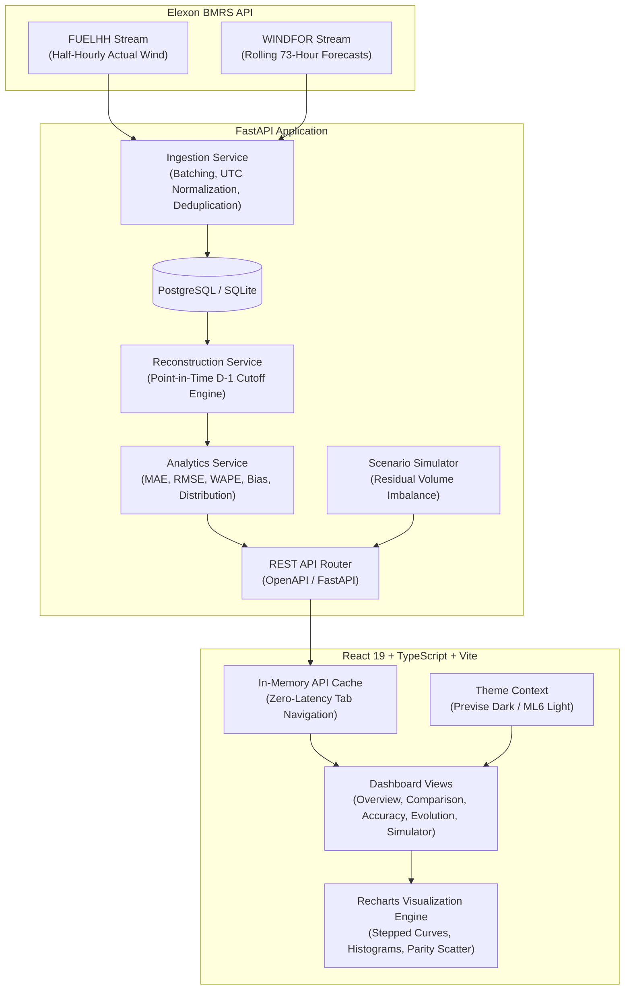

# e-consumption
### UK Wind Generation Forecast & Procurement Analytics Platform

[](https://e-cosume.vercel.app/)
[](https://e-consumption-api.onrender.com/docs)
[](https://fastapi.tiangolo.com)
[](https://react.dev)
[](https://www.typescriptlang.org)
[](https://tailwindcss.com)
[](https://www.postgresql.org)
[](https://www.docker.com)
[](https://docs.pytest.org)
[](https://vitest.dev)

---

## 1. Executive Summary & Business Context

In the UK wholesale electricity market, commercial utility procurement teams purchase power one day ahead ($D-1$) in daily wholesale auctions (e.g., EPEX SPOT UK Day-Ahead Auction and Nord Pool GB). 

Because wind generation is weather-dependent and non-dispatchable, procurement desks must forecast anticipated wind output across all 48 half-hourly settlement periods to determine how much residual thermal, hydro, or storage power must be secured in the auction:

$$\text{Residual Volume to Procure} = \text{Consumer Demand} - \text{Expected Wind Generation} - \text{Baseload Contracts}$$

### Volume Risk & Commercial Imbalance Exposure
* **Over-forecasting Wind ($\text{Forecast} > \text{Actual}$):** The utility procures too little conventional power day-ahead. During physical delivery, a generation deficit emerges. The utility is exposed to volatile cash-out imbalance penalties (System Buy Price) or emergency intraday balancing actions.
* **Under-forecasting Wind ($\text{Forecast} < \text{Actual}$):** The utility over-procures expensive thermal power. In real time, a physical surplus occurs, forcing the utility to spill power or sell it at discounted (or negative) System Sell Prices.

### Eliminating Lookahead Bias (The Core Requirement)
Day-ahead trading decisions close strictly at **11:00 GMT on $D-1$** (EPEX Day-Ahead auction gate closure). Evaluating procurement decisions against forecast revisions published later (e.g., intraday updates published 2 hours prior to physical delivery) introduces severe **lookahead bias (data leakage)**. 

This platform reconstructs the exact **frozen day-ahead forecast view** available commercially prior to the configured gate closure cutoff, matches it against delivered actuals for January 2026, and provides transparent accuracy, error distribution, and volumetric imbalance metrics.

---

## 2. Key Features

1. **Point-in-Time Day-Ahead Forecast Reconstruction:**
   * Strictly filters all forecast publications: $T_{\text{publish}} \le \text{Cutoff}_{D-1}$.
   * Dynamically selects the latest eligible forecast published prior to cutoff (default: **11:00 GMT on $D-1$**).
   * Fully configurable cutoffs (11:00 EPEX Spot, 12:00 Nord Pool, 16:00 Desk Close, 17:00 Evening Final).
2. **Preservation of Full Revision History:**
   * Ingests and retains all historical publications without overwriting.
   * Enables backtesting, auditability, and forecast drift analysis across rolling updates.
3. **Client-Side In-Memory Response Caching:**
   * High-efficiency in-memory response cache integrated into the frontend API service layer.
   * Eliminates redundant network round-trips when toggling between analytical modules (Overview, Comparison, Accuracy, Evolution).
   * Delivers zero-latency tab transitions without layout shifts or repeated loading spinners.
   * Features integrated cache invalidation tied to the global header refresh action.
4. **Dual Enterprise Design System:**
   * **Previse Coral Dark Enterprise Theme:** Slate navy trading desk aesthetic (`#0b131b` / `#13222f`) with high-contrast cyan, amber, and emerald stepped curves.
   * **ML6 Light Minimalist Theme:** Clean white and slate aesthetic with executive metric sidebars and stepped lines.
   * Instant one-click toggle with persisted preference.
5. **Interactive Analytical Modules:**
   * **Overview Dashboard:** Executive stats (Daily Avg, Peak MW, Actual Mean, Daily MAE, Directional Bias, Completeness) + 24-hour stepped profile + error delta bars + interval audit table.
   * **Actual vs. Forecast Comparison:** Multi-day continuous timeseries with brush zoom/pan, CSV export, and Parity Scatter Plot with $y = x$ reference line.
   * **Accuracy Analytics:** Statistical KPIs (MAE, RMSE, WAPE, Bias, Max AE, Median AE) + Daily performance bar chart + 24-hour Diurnal curve + 8-bin Error Distribution Histogram.
   * **Forecast Evolution Explorer:** Deep-dive into specific delivery hours (e.g., 17:00 evening peak) tracking the trajectory across 20+ revisions from $D-2$ through delivery.
   * **Illustrative Procurement Simulator:** Interactive baseline demand slider modeling residual procurement swings and volume shortfall/surplus exposure with explicit methodology notices.

---

## 3. Architecture & Tech Stack



### Technology Decisions
* **Frontend:** React 19, TypeScript, Vite, Tailwind CSS, Recharts, Lucide React.
* **Backend:** Python 3.11, FastAPI, Pydantic v2, SQLAlchemy 2, NumPy, Pandas, httpx, psycopg v3.
* **Database:** Cloud PostgreSQL (Supabase / Render) with zero-setup SQLite fallback for local development.
* **Containerization:** Multi-stage Dockerfiles and Docker Compose.
* **Testing:** Pytest (13 backend tests) and Vitest (4 frontend tests).

---

## 4. Empirical Elexon API Data Characteristics

The platform connects to live Elexon Insights Solution (BMRS) open data streams without authentication:

### A. Actual Generation (`FUELHH`)
* **Endpoint:** `https://data.elexon.co.uk/bmrs/api/v1/datasets/FUELHH/stream`
* **Filter:** `fuelType = "WIND"`
* **Granularity:** Half-hourly settlement periods (SP 1–48 per day).
* **Delivery Ingestion:** Jan 1, 2026 00:00 to Jan 31, 2026 23:30 (1,489 records captured).

### B. Forecast Generation (`WINDFOR`)
* **Endpoint:** `https://data.elexon.co.uk/bmrs/api/v1/datasets/WINDFOR/stream`
* **Cadence:** Published approximately 8 times per day at `:30` past the hour.
* **Granularity:** Hourly start times (`startTime` minute is `:00`).
* **Horizon:** Each snapshot publishes a **73-hour rolling horizon**.
* **Ingestion Window:** Commences Dec 28, 2025 to capture day-ahead forecasts for Jan 1, 2026 delivery (20,440 records captured).

### Resolution Harmonization (Hourly vs. Half-Hourly)
`WINDFOR` forecasts are issued at hourly resolution, while `FUELHH` actuals are issued at half-hourly settlement periods. The primary analytical engine pairs each hourly forecast with the average of its two constituent half-hourly settlement periods:

$$\text{Actual}_H = \frac{\text{Actual}_{H:00} + \text{Actual}_{H:30}}{2}$$

---

## 5. Mathematical Metric Definitions

Let $y_t$ be delivered actual generation (MW) and $\hat{y}_t(c)$ be the latest forecast published on or before cutoff $c$ on $D-1$:

$$\text{Forecast Error } (\Delta_t) = \hat{y}_t(c) - y_t$$

1. **Mean Absolute Error (MAE):**
   $$\text{MAE} = \frac{1}{N} \sum_{t=1}^{N} |\hat{y}_t - y_t|$$
2. **Root Mean Squared Error (RMSE):**
   $$\text{RMSE} = \sqrt{\frac{1}{N} \sum_{t=1}^{N} (\hat{y}_t - y_t)^2}$$
3. **Weighted Absolute Percentage Error (WAPE):**
   $$\text{WAPE} = \frac{\sum_{t=1}^{N} |\hat{y}_t - y_t|}{\sum_{t=1}^{N} y_t} \times 100\% \quad (\text{safe zero-denominator check})$$
4. **Forecast Bias (Mean Error):**
   $$\text{Bias} = \frac{1}{N} \sum_{t=1}^{N} (\hat{y}_t - y_t)$$
   * $\text{Bias} > 0$: Systematic over-forecasting (Shortfall / under-procurement exposure).
   * $\text{Bias} < 0$: Systematic under-forecasting (Surplus / over-procurement exposure).
5. **Data Completeness:**
   $$\text{Completeness} = \frac{N_{\text{valid}}}{N_{\text{expected}}} \times 100\%$$

---

## 6. Database Schema Design

Normalized PostgreSQL schema with unique constraints and composite indexes:

### `actual_generation`
| Column | Type | Constraints / Indexes |
|---|---|---|
| `id` | Integer | Primary Key, Autoincrement |
| `start_time` | Timestamp (tz) | NOT NULL, Indexed |
| `settlement_period` | Integer | NOT NULL (1–48) |
| `settlement_date` | String(10) | NOT NULL, Indexed |
| `fuel_type` | String(32) | NOT NULL, Default 'WIND' |
| `generation_mw` | Float | NOT NULL |
| `publish_time` | Timestamp (tz) | NOT NULL |
| `ingested_at` | Timestamp (tz) | NOT NULL, Default UTC now |
| **Constraint** | `UNIQUE (start_time, fuel_type)` | Idempotent deduplication |

### `forecast_generation`
| Column | Type | Constraints / Indexes |
|---|---|---|
| `id` | Integer | Primary Key, Autoincrement |
| `start_time` | Timestamp (tz) | NOT NULL, Indexed |
| `publish_time` | Timestamp (tz) | NOT NULL, Indexed |
| `generation_mw` | Float | NOT NULL |
| `dataset` | String(32) | NOT NULL, Default 'WINDFOR' |
| `ingested_at` | Timestamp (tz) | NOT NULL, Default UTC now |
| **Constraint** | `UNIQUE (start_time, publish_time)` | Preserves full publication history |
| **Index** | `idx_forecast_start_publish` | Fast point-in-time range queries |

### `ingestion_runs`
Audit table recording dataset name, requested ranges, records received, records inserted, status (`SUCCESS` / `FAILED`), and error details.

---

## 7. Live Production Deployments & Infrastructure

The platform is deployed across a decoupled cloud topology:

* **Production Web Application (Vercel):** [https://e-cosume.vercel.app/](https://e-cosume.vercel.app/)
  * Global Edge CDN distribution with automated SPA client routing.
  * In-memory client-side response caching for zero-latency module navigation.
* **Production REST API Service (Render):** [https://e-consumption-api.onrender.com](https://e-consumption-api.onrender.com)
  * Asynchronous FastAPI backend worker executing point-in-time reconstruction and statistical modeling.
  * Interactive OpenAPI Swagger Documentation: [https://e-consumption-api.onrender.com/docs](https://e-consumption-api.onrender.com/docs)
* **Cloud Database (Supabase PostgreSQL):**
  * Managed PostgreSQL instance in AWS Asia-Pacific (`aws-0-ap-northeast-2`).
  * Ingested and verified dataset: 1,489 `FUELHH` wind actuals and 20,440 `WINDFOR` forecasts for January 2026.
* **Source Repository:** [https://github.com/Vara715/e-cosume](https://github.com/Vara715/e-cosume)

---

## 8. Local Setup & Verification

### Prerequisites
* Python 3.11+
* Node.js v20+ and npm

### Local Execution
```bash
# Clone repository
git clone https://github.com/Vara715/e-cosume.git
cd e-cosume

# Backend Setup & Test Suite
pip install -r backend/requirements.txt
python -m pytest backend/tests -v

# Start Backend API Server
python -m uvicorn backend.app.main:app --port 8000 --reload

# Frontend Setup & Test Suite
cd frontend
npm install
npm test
npm run build
npm run dev
```

### Docker Orchestration
```bash
docker compose up --build
```
* **Frontend:** http://localhost:3000
* **Backend API & Swagger Docs:** http://localhost:8000/docs
* **PostgreSQL:** `localhost:5432` (`postgres:postgres`, database `wind_procurement`)

---

## 9. Automated Test Verification

### Backend Pytest Suite (13 Passed)
```
backend/tests/test_analytics.py::test_deterministic_metric_calculations PASSED
backend/tests/test_analytics.py::test_zero_actual_generation_wape_safety PASSED
backend/tests/test_analytics.py::test_systematic_under_forecasting_bias PASSED
backend/tests/test_api.py::test_api_health PASSED
backend/tests/test_api.py::test_api_metadata PASSED
backend/tests/test_api.py::test_api_overview PASSED
backend/tests/test_api.py::test_api_comparison PASSED
backend/tests/test_api.py::test_api_accuracy PASSED
backend/tests/test_api.py::test_api_scenario_simulation PASSED
backend/tests/test_api.py::test_api_invalid_date_format PASSED
backend/tests/test_reconstruction.py::test_day_ahead_selection_excludes_future_publications PASSED
backend/tests/test_reconstruction.py::test_reconstruction_with_alternative_cutoff PASSED
backend/tests/test_reconstruction.py::test_forecast_history_tracking PASSED

======================== 13 passed in 0.93s ========================
```

### Frontend Vitest Suite (4 Passed)
```
 PASS src/tests/MetricCard.test.tsx (2 tests)
 PASS src/tests/TabsNav.test.tsx (2 tests)

Test Files  2 passed (2)
     Tests  4 passed (4)
======================== 4 passed in 1.80s ========================
```

---

## 10. Known Domain Limitations & Engineering Boundary

1. **Exclusion of Consumer Demand:**
   The assignment explicitly excludes consumer demand datasets. Consequently, the platform **does not claim to compute true net commercial trade volumes or monetary trading positions**. Doing so without actual national demand data would be misleading. Instead, the platform focuses directly on **wind forecast uncertainty and volumetric delta exposure**, complemented by an interactive Illustrative Demand Simulator clearly labeled as a sensitivity tool.
2. **Hourly vs. Half-Hourly Resolution:**
   `WINDFOR` is published at hourly resolution, while `FUELHH` is published half-hourly. The platform averages the two half-hours to guarantee fair, physically valid energy comparisons while allowing users to inspect raw interval breakdowns.

---

## 11. AI Tools Disclosure

This application was engineered and developed using **Google Antigravity**, operating with an autonomous senior full-stack engineering workflow spanning domain research, Elexon API investigation, statistical modeling, database design, frontend implementation, testing, containerization, and documentation.
